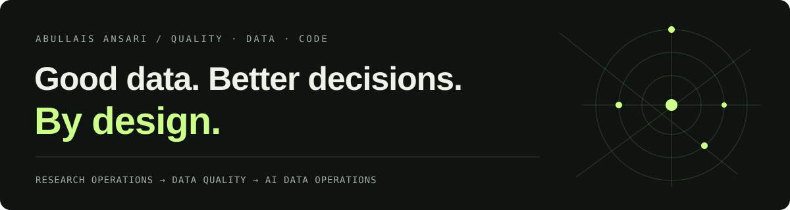

  

  <strong>Senior Quality Analyst · Data Research </strong> 
  Maharashtra, India

  <a href="https://abulaisansari7-dot.github.io/"><strong>Explore my portfolio ↗</strong></a>
  &nbsp;·&nbsp;
  <a href="https://www.linkedin.com/in/abullais-ansari-208a81179/">LinkedIn</a>
  &nbsp;·&nbsp;
  <a href="mailto:abulaisansari7@gmail.com">Email</a>

---

## Detail is the deliverable.

I’m **Abullais Ansari**. I work where research operations meet data discipline — turning complex research data into reliable output through quality assurance, human judgment, and technical thinking.

My career in research and quality began in **2016**. At **Datamatics Business Solutions Ltd**, I review research and data-verification pipelines, coordinate workflows and resource reporting, and train researchers on internal QA practices. Alongside this, I support **AI data operations** as a freelance consultant.

## What I bring

| Focus | Practical experience |
| --- | --- |
| **Research & quality** | Secondary research, entity-data validation, accuracy and consistency checks |
| **Data tools** | Advanced Excel, Power Query, Pivot Tables, dashboards, database management |
| **AI data operations** | Data annotation, search-query evaluation, prompt-response assessment, model output review, text-audio correction |
| **People & process** | Workflow coordination, resource-utilization reporting, researcher training, project scoping and turnaround-time estimation |

**Technical foundation:** Oracle 10g · PL/SQL · Python · Java · C# · .NET Framework

## Experience

- **Senior Quality Analyst · Datamatics Business Solutions Ltd**  
  May 2024–present; previously April 2019–October 2021. Research QA, data verification, team workflows, Excel datasets, and researcher training.
- **Freelance Consultant · AI Data Operations**  
  November 2021–present. Annotation, search evaluation, text-audio correction, and structured assessments of AI outputs.
- **Senior Research Associate · Datamatics Business Solutions Ltd**  
  April 2017–April 2019. Project scoping, turnaround-time estimation, and resource-utilization reporting.
- **Research Associate · Datamatics Business Solutions Ltd**  
  April 2016–April 2017. Secondary research and entity-data extraction and validation.

## Curiosity, put into code.

### [Orblitz ↗](https://github.com/abulaisansari7-dot/Orblitz-V1.1)

A **real-time multiplayer arena game** for **2–8 players**, built with Node.js.

- 60-second rounds, four collectible orb types, and combo multipliers up to ×4.
- Five temporary power-ups: dash, shield, magnet, overdrive, and phase.
- An arena that shrinks in the final 30 seconds.
- WASD / arrow controls on desktop and drag controls on mobile.

### [Personal portfolio ↗](https://abulaisansari7-dot.github.io/)

My work, experience, and technical interests in one place — with an interactive data field, filterable expertise, and a detailed career timeline.

[Browse the portfolio source](https://github.com/abulaisansari7-dot/abulaisansari7-dot.github.io)

## How I approach quality

**Understand the requirement → Validate the evidence → Review the output → Make the process repeatable.**

Clear requirements, careful checks, structured feedback, and practical training are the thread connecting my research, QA, and AI data work.

## Education & certification

- **B.Sc. in Information Technology** · University of Mumbai, Akbar Peerbhoy College of Commerce and Economics · First Class · 2012
- **Oracle 10g — DBA & PL/SQL** · TalentEdge (Arrina Education Services Pvt. Ltd.) · Grade A · 2013

---

**Open to Quality Analyst, QA, and Data Operations roles.**  
Have a role or project where detail matters? [Let’s connect](mailto:abulaisansari7@gmail.com).

Built with curiosity. Checked with care.
